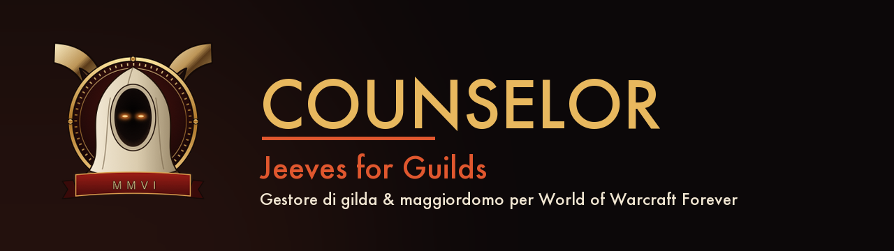

<div align="center">



**Gestore di gilda e maggiordomo per World of Warcraft Forever (Classic Era).**
Roster, classifiche DPS/HPS live, raid planner, calendario, bottino e il maggiordomo *Jeeves* — dentro il gioco e sul web.


</div>

---

## ✦ Cos'è

**Counselor** è un addon di gestione gilda per *WoW Forever*, affiancato da un piccolo companion desktop e da un portale web. Porta in gioco le stesse informazioni del sito della gilda — roster, gearscore, classifiche, calendario, composizioni raid — e aggiunge un **meter danni/cure in tempo reale** e il maggiordomo **Jeeves**.

L'addon è **gratuito e open source**. Vive in un'unica finestra elegante (l'*hub*): schede a sinistra, contenuto al centro, i danni live a destra.

## ✦ Caratteristiche

| | |
|---|---|
| 🏰 **Hub unico** | Una sola finestra: Cruscotto, DPS/HPS, Bottino, Calendario, Raid, Jeeves, Profilo. |
| ⚔️ **Meter DPS/HPS live** | Danni e cure in tempo reale di tutto il gruppo/raid, barre colore-classe, via l'API nativa del server. |
| 🟢 **Gilda ORA** | Chi è online adesso, in quale zona, a che livello e con quale gearscore. |
| 🎩 **Jeeves** | Il maggiordomo della gilda: consigli su classi, gear, zone, tattiche — in gioco e in chat. |
| 📣 **Call to Arms** | I membri segnano disponibilità (giorni/orari) ed entrano nella rosa del planner. |
| 🗡️ **Raid Planner** | Scelta raid con tattiche, rosa dei disponibili, composizione con vista gear del GM. |
| 📅 **Calendario & Bottino** | Eventi del mese e ultimi drop della gilda, sincronizzati col sito. |

## ✦ Come funziona

Gli addon di WoW non hanno accesso alla rete: per questo Counselor usa un'architettura a tre livelli.

```
┌──────────────┐   SavedVariables   ┌──────────────────┐   HTTPS   ┌─────────────┐
│  Addon (in    │ ─────────────────▶ │  Companion       │ ────────▶ │  Portale     │
│  gioco, Lua)  │   (al /reload o     │  (app desktop,   │           │  web          │
│               │    logout)          │   invisibile)    │ ◀──────── │  (roster,    │
│  raccoglie    │ ◀───────────────── │  file-watch +    │  snapshot │   Jeeves…)   │
│  dati & meter │   CounselorSnapshot │  upload          │           │              │
└──────────────┘                     └──────────────────┘           └─────────────┘
```

- **Addon** — raccoglie i dati del tuo personaggio, mostra l'hub e il meter live.
- **Companion** — piccola app desktop che gira invisibile in background: sincronizza i dati col portale (nessuna finestra, si installa da sola).
- **Portale** — dashboard web della gilda e Jeeves.

## ✦ Installazione

**1. Addon** — il modo più semplice:
- Da **CurseForge**: cerca *Counselor* e premi *Install*.
- Oppure scarica lo ZIP da [Releases](../../releases) e copialo in `Interface/AddOns/`.

**2. Companion** (per sincronizzare i dati col sito) — scaricalo dal portale e aprilo una volta: si installa da solo e parte in background a ogni avvio del PC. Vedi [`companion/PACKAGING.md`](companion/PACKAGING.md).

**3. Collegamento** — registrati sul portale, genera il *pairing-code* e incollalo nella scheda **Profilo** dell'addon. Fatto: da lì tutto è automatico.

## ✦ Struttura del repository

```
addon/Counselor/     L'addon in gioco (Lua) + texture
companion/           Il companion desktop (Python) + script di build
deploy/              Script di firma, installer e packaging CurseForge
```

> Nota: il server/portale web non fa parte di questo repository open source.

## ✦ Licenza

Distribuito con licenza **MIT**. Vedi [`LICENSE`](LICENSE).

© 2026–2030 **Stefano Scaramuzzino**.
